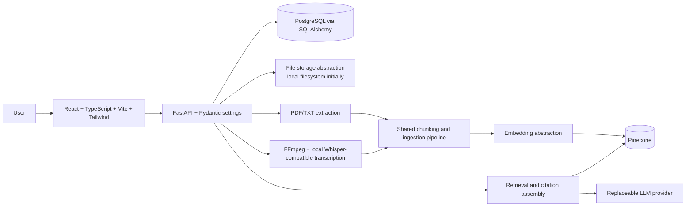

# Cognify AI

Cognify AI is a planned, standalone multimodal RAG application for helping learners search and study their own materials. Users will be able to upload documents and recordings, ask questions grounded in those sources, and navigate citations back to source pages or timestamps.

> **Current status:** The standalone FastAPI backend implements document metadata/upload and segment retrieval, PDF/TXT extraction foundations, Gemini embeddings, Pinecone upsert and semantic retrieval, and a grounded-answer pipeline with database-derived citations. Grounded answer generation requires explicit LLM model configuration. No frontend or media transcription is implemented.

## Problem and planned features

Learning materials are spread across documents and recordings, making it difficult to find relevant explanations and review specific topics. Cognify AI is planned to:

- Ingest PDF and TXT files, MP3/WAV audio, and MP4 video.
- Extract text from PDFs/TXT and extract video audio with FFmpeg.
- Transcribe audio/video with a locally run Whisper-compatible model, subject to model and hardware evaluation.
- Chunk extracted content, generate embeddings, and store vectors/searchable metadata in Pinecone.
- Retrieve relevant evidence for grounded answers with page/timestamp citations and abstain when evidence is insufficient.
- Offer short and detailed summaries, topic-wise notes, key concepts, and transcripts.

Retrieval and citations may reduce unsupported answers; they cannot guarantee or eliminate hallucinations. OCR, video-frame analysis, authentication, and reranking are out of v1 scope.

## Planned architecture and stack

PostgreSQL is for relational application data and processing state. Pinecone is for embeddings and searchable vector metadata. Original files use a separate storage abstraction. Details and open decisions are in [the architecture document](docs/ARCHITECTURE.md).

## Setup status

Backend setup, configuration, and run instructions are documented in [backend/README.md](backend/README.md). `POST /api/v1/retrieval/search` returns semantic matches; `POST /api/v1/retrieval/answer` loads retrieved text from PostgreSQL, generates a grounded answer, and returns citations derived from persisted source records. Answer requests require `LLM_PROVIDER=gemini`, an explicitly selected supported `LLM_MODEL`, `GEMINI_API_KEY`, Pinecone credentials, and a pre-created dimension-compatible index. The project does not select a generation-model default. Tests use fakes and do not call live services. The frontend and media transcription remain unimplemented.

The [.env.example](.env.example) file lists configuration names with placeholders only; consult [backend setup](backend/README.md) for active settings and required values. Do not put secrets in frontend code or commit `.env`.

## Documentation

- [Architecture](docs/ARCHITECTURE.md) and [data flow](docs/DATA_FLOW.md)
- [Proposed API contract](docs/API.md) (not implemented)
- [Evaluation plan](docs/EVALUATION.md)
- [Roadmap](ROADMAP.md), [contributor guide](CONTRIBUTING.md), and [persistent agent context](CONTEXT.md)

## Security and cost

The initial MVP is unauthenticated and must not be exposed publicly without appropriate access controls. Treat uploads and extracted content as untrusted; apply file limits, safe temporary-file handling, timeouts, and explicit error handling when those features are implemented. Keep credentials on the backend and use a secret store for deployed environments.

Prefer local/free development options where practical. Pinecone is the planned vector service, but paid cloud infrastructure must not be a mandatory development dependency. Evaluate service tiers, quotas, model/runtime resource needs, licensing, and external-provider data handling before choosing operational defaults. Do not send private content to an external provider without an explicit privacy and retention decision.
