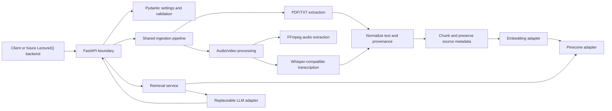

# Architecture

> **Status:** Target architecture, not implemented. This document records the intended boundaries and open choices; it is not a deployment specification.

## Goals and boundaries

Cognify AI is an independently runnable multimodal RAG service. It accepts PDF, TXT, audio, and video inputs; extracts or transcribes content; indexes retrievable chunks; and supports grounded answers, summaries, and study notes with source provenance where available. LectureIQ may call it later through its Express backend. No LectureIQ code or integration is part of v1.

The initial service is unauthenticated. Treat it as trusted local/development software unless access controls are added and reviewed. It will not include reranking in v1.

## Logical architecture

The diagram expresses intended boundaries only. The technology choices within adapters remain subject to evaluation; Pinecone is the planned vector store.

## Component responsibilities

- **API boundary:** request validation, upload constraints, response schemas, and translation of known service failures to explicit HTTP errors.
- **Settings:** typed configuration through Pydantic; secrets supplied via environment or a secret manager, never committed.
- **Extraction:** direct PDF/TXT text extraction; audio transcription; video audio extraction with FFmpeg followed by transcription. Preserve page and timestamp provenance when available.
- **Shared ingestion:** normalize extractor output, chunk content as appropriate, attach source metadata, generate embeddings, and persist vectors and retrievable text.
- **Retrieval:** apply configurable top-k, similarity threshold, and metadata filters; do not rerank in v1.
- **Generation:** pass retrieved evidence to a provider-neutral LLM interface; return evidence-linked citations and abstain when evidence does not support an answer.
- **Adapters:** isolate Pinecone, embedding, transcription, and LLM provider details so they can be evaluated or replaced without changing API semantics.

## Data and provenance

Each indexed unit should retain source identity and enough location information to cite it: page number for PDF pages when available, and start/end timestamps for media segments when available. Plain text sources should retain a stable source identifier. Avoid treating generated summaries as source evidence unless their provenance and use are explicit.

The exact metadata schema, chunking algorithm, overlap, embedding dimensions/versioning, and Pinecone namespace strategy are open implementation decisions. Changing embedding model/dimension may require a separate index or re-embedding; define migration behavior before production use.

## Configuration and external dependencies

`.env.example` is illustrative and contains placeholders only. It does not establish supported configuration names or imply credentials/models are available. Confirm exact settings, provider SDKs, Pinecone index configuration, local model requirements, FFmpeg availability, model licenses, and resource needs during implementation/evaluation.

Prefer low-cost development choices, but compare privacy, licensing, quality, operational cost, and latency before selecting model/provider combinations. Keep service startup errors explicit when a required integration is unavailable.

## Security and privacy

- **No authentication in v1:** do not expose the service publicly or on an untrusted network without suitable authentication/authorization and access controls.
- Enforce file type and byte-size limits before processing. Treat filenames and extracted content as untrusted input; use safe temporary-file handling and avoid shell interpolation.
- Set limits/timeouts for CPU-, memory-, and provider-intensive work; define cleanup and retention for uploaded files, extracted text, logs, and model caches.
- Keep API keys out of code, logs, traces, error responses, and version control. Use local environment configuration for development and a suitable secret store in deployment.
- Do not assume content is safe to send to external embedding or LLM providers. Decide data residency, consent, retention, and provider terms before enabling such providers.
- Plan for malicious PDFs/media, parser and FFmpeg vulnerabilities, prompt injection in retrieved text, denial-of-service uploads, and sensitive content exposure. Retrieved text is data, not trusted instructions.
- Add transport security and operational monitoring when deployment is designed. No deployment, access control, or privacy guarantees are implemented by this baseline.

## Reliability and failure behavior

Extraction, transcription, embedding, vector-store, and LLM failures must be explicit and diagnosable without leaking secrets or document contents. Do not report successful ingestion for partial/empty failed extraction. Define idempotency, retry behavior, cleanup, and partial-ingestion semantics when implementing persistence.

## Open decisions

1. Supported Python version, package manager, and project/test layout.
2. PDF parser and exact accepted file formats/limits.
3. Embedding model/provider, dimension, licensing, and re-indexing strategy.
4. Pinecone index region, metric, namespaces, metadata schema, and cost controls.
5. Whisper-compatible model/runtime, hardware requirements, model license, and FFmpeg distribution strategy.
6. Initial LLM provider/model and policy for content sent to it.
7. Chunking/semantic segmentation policy and citation representation.
8. Deployment, authentication, retention, and operational requirements before any non-local exposure.

See [ADR 0001](decisions/0001-initial-architecture.md) and the [evaluation plan](EVALUATION.md).
