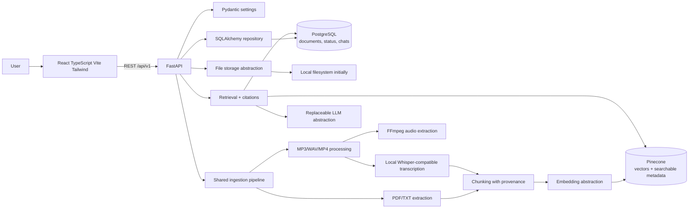

# Architecture

> **Status:** Target architecture. The backend currently implements a minimal FastAPI health endpoint, settings, lazy SQLAlchemy session foundation, a `Document` ORM model, and Alembic migrations. The broader integrations and multimodal RAG components described here remain planned.

## Goals and boundaries

Cognify AI is an independently runnable multimodal RAG application. The planned React frontend communicates with its FastAPI backend. PostgreSQL stores relational application and processing data; Pinecone stores vectors and searchable metadata; original files are managed by a separate storage abstraction. Future LectureIQ integration is through its existing Express backend. LectureIQ remains separate and is not part of this repository's implementation scope.

MVP authentication is out of scope. Do not expose the backend publicly without appropriate access controls. OCR, video-frame analysis, and reranking are not required for v1.

## Logical architecture

The diagram expresses intended boundaries only. Pinecone is the planned vector store, not a required paid development dependency. HTTPX may be used for outbound HTTP integrations where useful; no provider/model is selected.

## Component responsibilities

- **API boundary:** request validation, upload constraints, response schemas, and translation of known service failures to explicit HTTP errors.
- **Settings:** typed configuration through Pydantic; secrets supplied via environment or a secret manager, never committed.
- **Frontend:** upload/document management, chat, and summaries/notes/transcript views. Keep all provider/database credentials on the backend.
- **Relational persistence:** SQLAlchemy/PostgreSQL for document records, processing status/errors, optional ownership/course associations, chat sessions/messages, and source/processing metadata. The initial `Document` table has been created through Alembic; future schema changes must also use reviewed migrations.
- **File storage:** independent abstraction for original files; local filesystem is acceptable initially. Define safe paths, lifecycle, and retention before implementation.
- **Extraction:** direct PDF/TXT text extraction; MP3/WAV transcription; MP4 audio extraction with FFmpeg followed by transcription. Preserve page and timestamp provenance when available. OCR and video-frame analysis are deferred.
- **Shared ingestion:** normalize extractor output, chunk content as appropriate, attach source metadata, generate embeddings, and persist vectors and retrievable text.
- **Retrieval:** apply configurable top-k, similarity threshold, and metadata filters; do not rerank in v1.
- **Generation:** pass retrieved evidence to a provider-neutral LLM interface; return evidence-linked citations and abstain when evidence does not support an answer.
- **Adapters:** isolate Pinecone, embedding, transcription, file-storage, and LLM provider details so they can be evaluated or replaced without changing API semantics.

PostgreSQL is the relational source of truth; Pinecone stores vectors and only the searchable metadata needed for retrieval. Original binary files belong to file storage. Define cross-store deletion, retry, and consistency behavior before implementation.

## Data and provenance

Each indexed unit should retain source identity and enough location information to cite it: page number for PDF pages when available, and start/end timestamps for media segments when available. Plain text sources should retain a stable source identifier. Avoid treating generated summaries as source evidence unless their provenance and use are explicit.

The exact metadata schema, chunking algorithm, overlap, embedding dimensions/versioning, and Pinecone namespace strategy are open implementation decisions. Changing embedding model/dimension may require a separate index or re-embedding; define migration behavior before production use.

## Configuration and external dependencies

`.env.example` lists planned variable names with placeholders only. It does not establish validated runtime settings or imply credentials/models are available. Confirm exact settings, provider SDKs, PostgreSQL setup, Pinecone index configuration and cost, local model requirements, FFmpeg availability, model licenses, and resource needs during implementation/evaluation.

Prefer low-cost development choices, but compare privacy, licensing, quality, operational cost, and latency before selecting model/provider combinations. Keep service startup errors explicit when a required integration is unavailable.

## Security and privacy

- **No authentication in v1:** do not expose the service publicly or on an untrusted network without suitable authentication/authorization and access controls.
- Enforce file type and byte-size limits before processing. Treat filenames and extracted content as untrusted input; use safe temporary-file handling and avoid shell interpolation.
- Set limits/timeouts for CPU-, memory-, and provider-intensive work; define cleanup and retention for uploaded files, extracted text, logs, and model caches.
- Keep API keys out of code, logs, traces, error responses, and version control. Use local environment configuration for development and a suitable secret store in deployment.
- Do not assume content is safe to send to external embedding or LLM providers. Decide data residency, consent, retention, and provider terms before enabling such providers.
- Plan for malicious PDFs/media, parser and FFmpeg vulnerabilities, prompt injection in retrieved text, denial-of-service uploads, and sensitive content exposure. Retrieved text is data, not trusted instructions.
- Add transport security and operational monitoring when deployment is designed. No deployment, access control, or privacy guarantees are implemented by this baseline.

## Reliability and failure behavior

Extraction, transcription, embedding, vector-store, and LLM failures must be explicit and diagnosable without leaking secrets or document contents. Do not report successful ingestion for partial/empty failed extraction. Define idempotency, retry behavior, cleanup, and partial-ingestion semantics when implementing persistence.

## Open decisions

1. Supported Python/Node versions, package managers, project layouts, and test/lint tools.
2. PostgreSQL development setup details; PDF parser and upload limits.
3. File storage lifecycle/retention and cross-store deletion semantics.
4. Embedding model/provider, dimensions, licensing, re-indexing strategy; Pinecone index, metadata, and cost controls.
5. Whisper-compatible model/runtime, hardware, model license, and FFmpeg distribution.
6. Initial LLM provider/model and policy for content sent externally.
7. Chunking/citation representation; API contracts and synchronous versus asynchronous processing.
8. Deployment, privacy, retention, and access controls before non-local exposure.

See [ADR 0001](decisions/0001-initial-architecture.md) and the [evaluation plan](EVALUATION.md).
