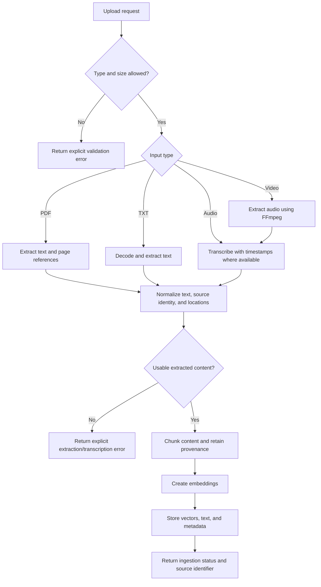
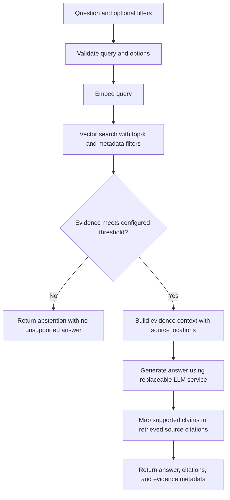

# Data flow

> **Status:** Proposed flow. No ingestion or retrieval implementation exists yet.

## Ingestion

### Ingestion requirements

1. Validate supported media type and configured byte-size limit; do not trust a filename extension alone.
2. Extract PDF/TXT directly. For audio/video, transcribe speech; video audio is extracted with FFmpeg. Timestamp availability and quality depend on the selected extractor/model.
3. Normalize all extractor output to a shared representation while retaining source ID, content type, and location (page or time range where possible).
4. Apply an evaluated chunking strategy; create embeddings and persist the chunk text and metadata alongside vectors.
5. Make failure and partial-success semantics explicit. Do not silently index empty content or claim full ingestion when a required step failed.

Temporary-file lifecycle, deduplication, idempotency, and retry behavior must be defined during implementation.

## Retrieval and answer generation

### Retrieval requirements

- Apply configurable top-k, similarity threshold, and metadata filters; document score semantics for the selected vector backend.
- No reranking in v1.
- Treat retrieved text as untrusted content, not system instructions.
- Abstain when evidence is absent, below threshold, or does not support the requested answer. Threshold alone is not proof that a generated answer is correct.
- Preserve PDF page and audio/video timestamp references in results and citations whenever the source extraction provides them.
- Tests should include relevant and irrelevant queries, metadata filtering, threshold boundaries, citation mapping, unanswerable questions, and vector/embedding/LLM errors.
