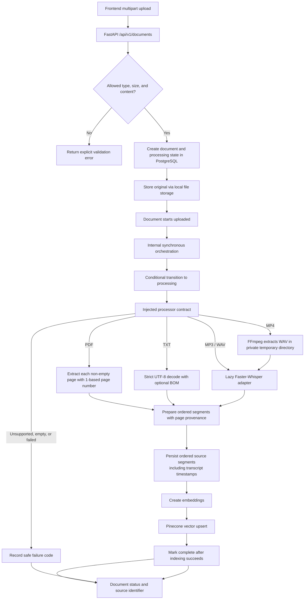
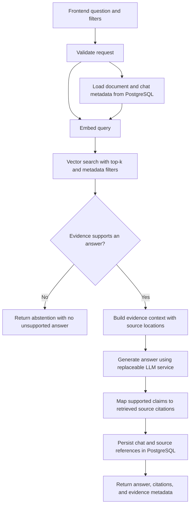

# Data flow

> **Status:** Upload, durable document processing, PDF/TXT extraction, MP3/WAV transcription, MP4 audio extraction and transcription, PostgreSQL segment persistence, embedding, and Pinecone upsert are implemented. The worker persists segments before indexing and marks processing complete only after successful upsert. Pinecone and Gemini behavior has not been verified with live credentials. Video-frame extraction is not implemented.

## Ingestion

### Ingestion requirements

1. Validate supported formats (PDF, TXT, MP3, WAV, MP4), actual content where practical, and configured size limits; do not trust only filename or client MIME type.
2. Create document/processing metadata in PostgreSQL and persist the original through the separate file storage abstraction.
3. PDF/TXT extraction is implemented by the local processor: PDF output is page-separated with 1-based provenance, and TXT uses strict UTF-8 decoding with optional BOM support. MP3/WAV transcription uses one lazily loaded Faster-Whisper adapter reused for the worker lifetime. MP4 audio is extracted to a private per-invocation temporary WAV, then sent to the same transcriber. Transcript text and start/end timestamps are persisted as ordered segments. MP4 timestamps are relative to the extracted WAV; the FFmpeg extractor does not expose or restore an audio-stream offset in the original container.
4. Normalize extraction output into ordered segments with source identity and provenance. Semantic chunking is not implemented; PDF extraction currently preserves page-level segments and TXT extraction produces text segments.
5. Generate embeddings through the existing embedding abstraction and upsert vectors plus minimal searchable metadata into the configured existing Pinecone index and namespace. The adapter verifies the configured index dimensions and cosine metric, uses stable document/segment-derived vector IDs, and batches upserts. Upserts and similarity queries use the same configured namespace; retrieval retains the document UUID metadata filter. Keep relational state in PostgreSQL and originals in file storage.
6. The document worker persists extracted/transcribed segments in PostgreSQL before embedding and upsert; its database session is closed during provider calls. Processing completes only after successful indexing. Extraction and transcription failures use the existing safe failure code and job retries (up to three attempts); a failed job does not prevent subsequent queued jobs from being processed. Worker/transcription tests use deterministic fakes and isolated SQLite: they do not verify real Whisper inference or live PostgreSQL/Pinecone integration. PostgreSQL and Pinecone cannot commit atomically; partial upserts can leave stale vectors. Do not silently index empty content or claim full success when a required step failed.

The processor removes its temporary WAV after transcription on success or failure; the FFmpeg extractor manages its own intermediate output files. Retries repeat extraction and transcription. Deduplication and cross-store idempotency remain future concerns.

## Retrieval and answer generation

### Retrieval requirements

- Apply configurable top-k, similarity threshold, and metadata filters; document score semantics for the selected vector backend.
- No reranking in v1.
- Treat retrieved text as untrusted content, not system instructions.
- Abstain when evidence is absent, below threshold, or does not support the requested answer. Threshold alone is not proof that a generated answer is correct.
- Preserve PDF page and audio/video timestamp references in results and citations whenever the source extraction provides them.
- Store chat/session and relational source records in PostgreSQL; keep vectors/searchable metadata in Pinecone and original bytes in file storage.
- Tests should include relevant and irrelevant queries, metadata filtering, threshold boundaries, citation mapping, unanswerable questions, and vector/embedding/LLM errors.

Short/detailed summaries, topic-wise notes, key concepts, and transcripts are planned outputs scoped to source material. Preserve source references where practical and do not treat generated text as authoritative source evidence by default.
