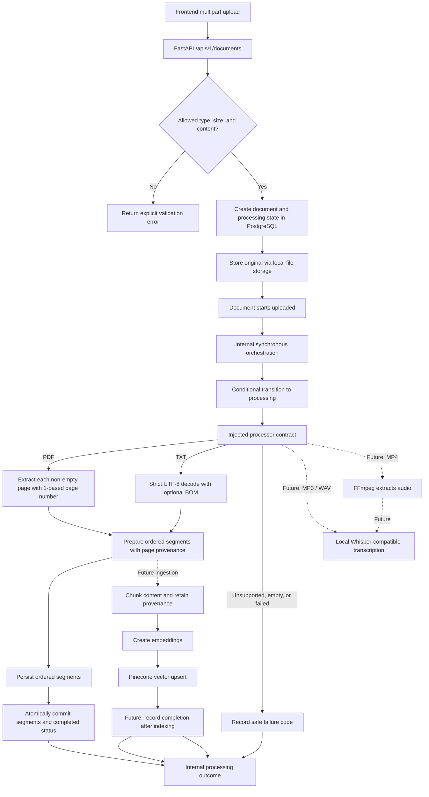
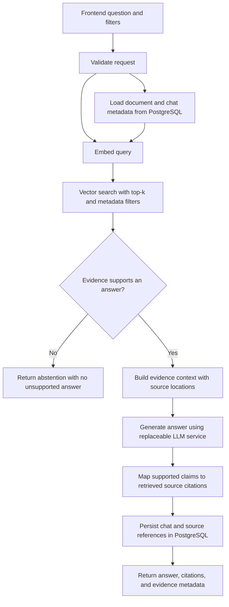

# Data flow

> **Status:** Upload, document persistence, lifecycle management, an internal synchronous processor/orchestrator, local PDF/TXT extraction, and extracted-segment persistence are implemented. Extraction runs outside transactions; segment persistence and completion share one transaction. The processing path is not exposed by an HTTP endpoint. Audio/video transcription and downstream indexing remain proposed.

## Ingestion

### Ingestion requirements

1. Validate supported formats (PDF, TXT, MP3, WAV, MP4), actual content where practical, and configured size limits; do not trust only filename or client MIME type.
2. Create document/processing metadata in PostgreSQL and persist the original through the separate file storage abstraction.
3. PDF/TXT extraction is implemented by the local processor: PDF output is page-separated with 1-based provenance, and TXT uses strict UTF-8 decoding with optional BOM support. Transcribing MP3/WAV with a selected local model and using FFmpeg to extract MP4 audio remain future work.
4. Normalize output into a shared representation, retain source ID/type/location, and chunk while preserving page/time ranges where available.
5. Generate embeddings through an abstraction and upsert vectors plus minimal searchable metadata into Pinecone. Keep relational state in PostgreSQL and originals in file storage.
6. The internal processor persists extracted segments in PostgreSQL; no endpoint invokes it. Persistence and completion commit atomically after extraction. Continue to make retry, partial failure, cleanup, idempotency, and cross-store consistency explicit before adding indexing. Do not silently index empty content or claim full success when a required step failed.

Temporary-file lifecycle, deduplication, idempotency, and retry behavior must be defined during implementation.

## Retrieval and answer generation

### Retrieval requirements

- Apply configurable top-k, similarity threshold, and metadata filters; document score semantics for the selected vector backend.
- No reranking in v1.
- Treat retrieved text as untrusted content, not system instructions.
- Abstain when evidence is absent, below threshold, or does not support the requested answer. Threshold alone is not proof that a generated answer is correct.
- Preserve PDF page and audio/video timestamp references in results and citations whenever the source extraction provides them.
- Store chat/session and relational source records in PostgreSQL; keep vectors/searchable metadata in Pinecone and original bytes in file storage.
- Tests should include relevant and irrelevant queries, metadata filtering, threshold boundaries, citation mapping, unanswerable questions, and vector/embedding/LLM errors.

Short/detailed summaries, topic-wise notes, key concepts, and transcripts are planned outputs scoped to source material. Preserve source references where practical and do not treat generated text as authoritative source evidence by default.
